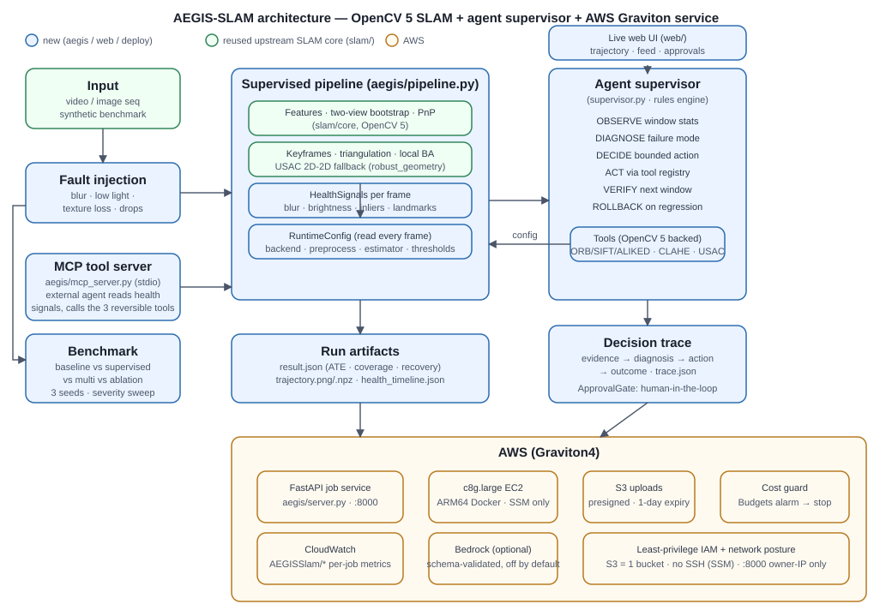
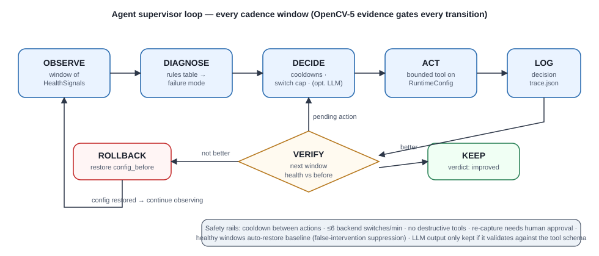
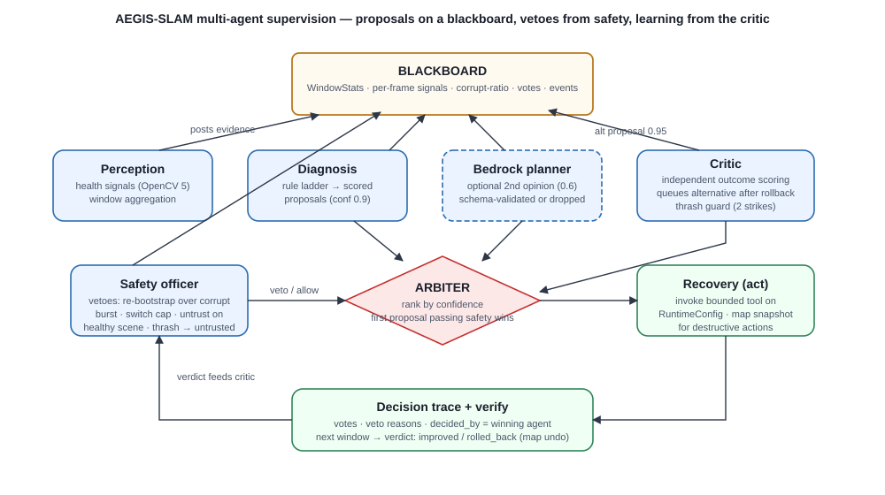
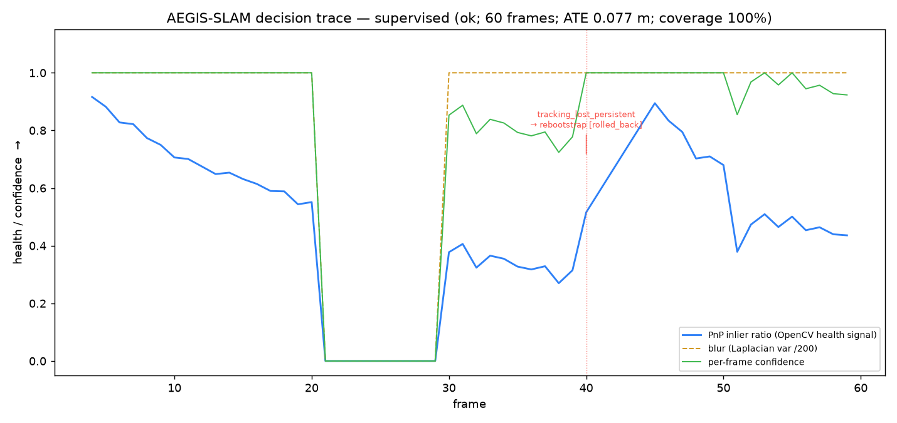
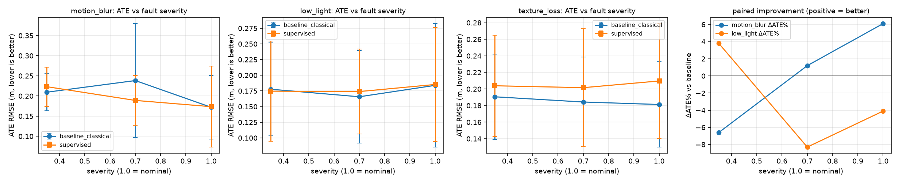
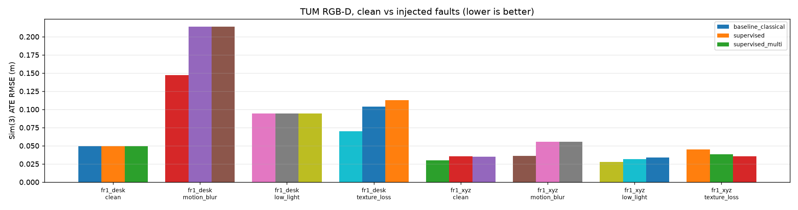

# AEGIS-SLAM — Technical Report

*Self-healing visual SLAM on OpenCV 5 with an observe→diagnose→act→verify agent
supervisor, deployed on AWS Graviton. **AEGIS** = Adaptive Estimation via
Guarded Intelligent Supervision.*
OpenCV AI Competition 2026 · base pipeline: KlrShaK/opencv-SimpleSLAM (Apache-2.0,
see `NOTICE`).

---

## 1. Problem and thesis

Feature-based monocular SLAM degrades **silently**. ORB + RANSAC + PnP assumes
enough texture, enough contrast, low motion blur, and roughly continuous input.
When a scene violates one assumption the estimator keeps producing poses whose
confidence no component checks: blur kills the Laplacian of features, low light
kills contrast, a blank wall kills matches, a dropped-frame burst kills tracking
— and the output trajectory looks just as plausible as a good one.

**AEGIS-SLAM's thesis:** wrap the SLAM core in a small, auditable agent that
(a) measures *why* tracking is failing from OpenCV-level evidence, (b) takes one
bounded corrective action from a fixed tool registry, and (c) **verifies the
action on the next window and rolls it back if it did not help** — logging every
step to a decision trace that a human (or a judge, or a CI log) can audit.

We chose "agent" in the pragmatic engineering sense: a rules engine over
measurable signals with the smallest autonomy that yields real recovery — not
an LLM loosely supervising math from the outside. An optional Bedrock planner
exists for ambiguous diagnoses, but its output is discarded unless it validates
against the tool schema, so the reproducible rule path is always the floor.

## 2. System overview



* **SLAM core (reused, `slam/`)** — ORB/SIFT features, two-view bootstrap with
  H-vs-F competition, PnP+RANSAC tracking, const-velocity prediction, keyframe
  policy, two-view triangulation, local bundle adjustment (pyceres) best-effort.
* **Supervisor (new, `aegis/`)** — `health.py` → `supervisor.py` →
  `tools.py` with `trace.py` and `approval.py`; integrated in `pipeline.py`.
* **Service (new)** — FastAPI job service (`server.py`) + live web UI (`web/`):
  progress, trajectory + health timeline plots, decision feed, re-capture
  approval card. `/version` proves OpenCV 5 + Graviton from the live host.
* **Deploy (new, `deploy/`)** — multi-arch Docker on `c8g.large`, least-privilege
  IAM, S3 1-day retention lifecycle, owner-IP-only security group, SSM Session
  Manager (no SSH), Budgets cost guard.



## 3. Method — what each stage does and why

### 3.1 Observe (health signals, OpenCV 5)

Per frame: Laplacian variance (blur), mean/std (brightness, contrast), Sobel
gradient energy (texture), detector keypoint count, PnP inliers/ratio, mean
reprojection error, tracked landmark count, frame-to-frame matches, lost flag.
The pure image statistics (Laplacian/mean/std/Sobel) are sub-millisecond `cv2`
calls; the full signal assembly including the ORB keypoint count measures
**16.4 ms p50 / 23.3 p95** on x86 dev hardware (`python -m aegis.bench`,
`eval/bench.json`) — to be re-measured on Graviton. The supervisor aggregates a
20-frame window (medians for image stats, means for tracking stats) and a composite
`health_score = 0.6·min(inlier_ratio/0.5,1) + 0.4·min(landmarks/120,1)`.

### 3.2 Diagnose (failure mode table)

Ordered rules, first match wins:

| Diagnosis | Evidence (window medians/means) | Action (tool) |
|---|---|---|
| `corrupted_input` | ≥3 lost frames ∧ ≥50 % of window frames are near-black (brightness<40) with blur_var<2 | `mark_segment_untrusted` — wait it out, never re-bootstrap (partial 30–50 % bursts are caught by the multi-agent safety veto) |
| `tracking_lost_persistent` | ≥3 lost frames in **two consecutive** windows | `rebootstrap` (undoable: map snapshot first; verified on **map size**) |
| `motion_blur` | blur_var < *adaptive* floor ∧ (inlier_ratio < *adaptive* floor ∨ inliers < *adaptive* floor) | `abstain` — sharpen only raised the inlier proxy while ATE worsened (measured, §5.4) |
| `low_light` | brightness < *adaptive* dark floor ∨ contrast < *adaptive* contrast floor, features < 800 | `apply_preprocessing(clahe)` |
| `textureless` | feature_count < *adaptive* feature floor | `set_feature_backend(sift)` else `mark_segment_untrusted` |
| `dynamic_or_repetitive` | features > 600 ∧ inlier_ratio < *adaptive* floor ∧ no lost frames | `retune_thresholds(usac, tighter ransac_px)` |
| `weak_geometry` | still < 0.35 after USAC | `retune_thresholds(+2000 max_features)` |
| *(multi critic, motion_blur alt)* | primary blur fix failed verification | `retune_thresholds(usac_magsac)` — threshold-free consensus |
| healthy | score ≥ 0.6 | restore baseline backend/preprocess (false-intervention suppression) |

### 3.3 Act (bounded tool registry)

Seven tools, all mutating one `RuntimeConfig` the pipeline reads every frame
(or recording a no-op decision): `set_feature_backend` (ORB/SIFT/ALIKED+LightGlue),
`apply_preprocessing` (CLAHE / NL-means denoise / unsharp — all `cv2`),
`retune_thresholds` (RANSAC px, PnP min-inliers, feature cap, robust estimator
`ransac → usac_accurate → usac_magsac`), `rebootstrap` (drop map, re-initialise,
undoable via map snapshot), `mark_segment_untrusted`, `request_recapture`
(human approval; otherwise the segment is marked untrusted), `abstain`.
No tool can delete data or stop the run; backend switches are capped at 6/min;
every action has a 20-frame cooldown.

### 3.4 Verify / rollback (the differentiator)

Each verifiable action records the metric it was supposed to improve and its
pre-action value. At the next window the supervisor compares: improvement
≥ 3 % (relative) → `improved`, keep; otherwise **restore `config_before`** and
mark `rolled_back`. Ablation mode disables verification for measurement.

Two upgrades make verification cover the *destructive* actions too:

* **Undoable re-bootstrap.** Before `rebootstrap` clears the map, the pipeline
  snapshots the point/pose/keyframe containers. Re-bootstrap is now a
  *verifiable* tool: if post-reboot health does not improve, the supervisor
  rolls back the config **and flags the pipeline to restore the map snapshot**
  — a genuinely undone destructive action, not just a setting revert.
* **Persistence gate.** Recovery actions fire only when failure **persists
  across two consecutive windows**. A transient burst (e.g. dropped frames)
  that self-recovers is never met with a map-destroying re-bootstrap — this
  fix came directly from our own negative result (§5.3). The re-bootstrap
  escalation counter resets once tracking is healthy again, so a later fresh
  episode gets the same two-window grace instead of instant recapture.

### 3.5 Per-frame confidence

Every frame carries a `confidence ∈ [0,1]` from its tracking evidence
(inlier ratio + landmark coverage; 0 while lost/uninitialised). It is written
to `health_timeline.json`, `result.json` (mean/p10/min), `trajectory.npz`, and
colored onto the trajectory plot — consumers can gate on it instead of
trusting every pose.

### 3.6 Multi-agent supervision (`supervised_multi`)

The single rule engine is refactored into five role-separated agents that
exchange scored **proposals** on a shared **blackboard**:

* **Perception** — window aggregation plus derived facts that medians hide: the
  `corrupt_ratio` (share of near-black, zero-variance frames) makes a 30–50 %
  dropped-frame burst visible even when window medians look normal.
* **Diagnosis** — the reproducible ladder of §3.2 (proposal confidence 0.9).
* **Bedrock planner** (optional) — a second vote at 0.6, kept only if it
  validates against the tool schema.
* **Critic** — independently re-scores every action at verify time. After a
  rollback it **queues the alternative fix** for that failure mode at 0.95 so
  the next round outranks repeating the failed primary, and is **blur-aware**:
  when the window's Laplacian variance says the scene is blurred, it swaps the
  generic alternative for OpenCV-5's threshold-free **USAC_MAGSAC** retune —
  blur is a noise-scale problem, and MAGSAC needs no fixed px threshold. After
  two consecutive failures of the same diagnosis the **thrash guard** refuses
  further retuning and marks the segment untrusted instead.
* **Safety officer** — hard vetoes regardless of the rules' confidence: no
  re-bootstrap while ≥30 % of window frames are corrupted (exactly the failure
  we measured in v1), backend-switch cap enforcement, and refusing to distrust
  a healthy scene.
* **Arbiter** — ranks proposals, takes the highest non-vetoed one, falls back
  to the least-harmful action when everything is vetoed.

Each trace record gains the full `votes` array (agent, tool, confidence, veto
reason) and `decided_by` becomes the winning agent, so deliberation itself is
auditable. The single-agent mode is retained for A/B measurement; results in
§5.4.



### 3.7 Decision trace (FR-5)

Every decision is one JSON record — `decision_id`, frame, compact OpenCV
evidence, diagnosis, `decided_by: rules|bedrock|fallback`, action+args,
`config_before/after`, outcome with verdict. This is written incrementally and
served live by the UI; `summary()` aggregates decisions/switches/verdicts.



*Annotated trace walkthrough — the shipped `frame_drop` supervised seed-0 run
(`eval/dev/`, §5.2). The Laplacian-variance signal (gold, dashed) collapses with
the injected black burst (~frames 20–39); the PnP inlier ratio (blue) and
per-frame confidence (green) collapse with it. Tracking is lost for two
consecutive windows, so the supervisor fires `rebootstrap` at frame 40 — and the
verification window rolls it back (red) because the next window's ATE did not
improve. Final ATE 0.077 m vs 0.070 m baseline (+9.8 %): the gate refused to
keep an action that looked plausible from the proxy but measured worse, and the
trace records every step. This is the end-to-end "OpenCV-5 observation changed a
later decision" evidence.*

## 4. OpenCV 5 usage and what we learned (spikes)

* **USAC family (OpenCV-5's headline robust-estimation upgrade).** The
  estimator tool maps to `cv2.USAC_ACCURATE` and `cv2.USAC_MAGSAC` constants in
  `findFundamentalMat`/`findHomography`. Spike on noisy synthetic matches:
  **USAC 169 vs RANSAC 126 inliers**. `USAC_MAGSAC` is the *threshold-free*
  variant: instead of a fixed px threshold it integrates over all consensus
  sizes, which is the right model for motion-blurred frames where the epipolar
  noise scale itself is uncertain — it is the critic agent's learned second
  line for `motion_blur`, and selectable via `--estimator usac_magsac`. Notes:
  `opencv-python 5.0.0.93` has no `cv2.usac` module, no `createUSAC*`
  factories, and `solvePnPRansac` accepts no USAC method (verified against the
  wheel) — the method constants are the supported API; we fall back to RANSAC
  on `cv2.error`. `GET /version` reports which USAC variants the build ships.
* **G-API is NOT in the headless wheel** (`cv2.gapi` missing) — a fused
  signal-extraction graph would have been the fastest path; measured, excluded,
  documented rather than shipped broken.
* **`cv2.AKAZE_create` is absent from the wheel**, so the backend tool is
  limited to orb/sift/aliked.
* CLAHE on LAB, `fastNlMeansDenoisingColored`, unsharp via `addWeighted`,
  Laplacian/Sobel signals, `findEssentialMat`/`recoverPose`, `triangulatePoints`
  — all through the v5 API; `GET /version` dumps `cv2.getBuildInformation()`.

## 5. Evaluation

### 5.1 Protocol

Benchmarks must be reproducible offline, so we ship **`aegis/synth.py`**: a
synthetic TUM-style dataset (point cloud projected through a moving pinhole
camera, ground-truth poses + intrinsics + optional mp4). Faults are injected
mid-clip (35–65 % of frames) by `faults.py`: linear-kernel **motion_blur**,
gamma+noise **low_light**, moving blurred patch **texture_loss**, black-burst
**frame_drop**. Conditions: `baseline_classical` (no agent), `supervised`
(single rule-engine agent), `supervised_multi` (five-role agent panel, §5.5),
`ablation` (identical actions, verification disabled). Metrics: **ATE RMSE** after
Umeyama Sim(3) alignment (honest about monocular scale), **coverage** (fraction
of frames with trusted pose), **frames-to-recover** after fault onset, decision
counts from the trace. Each estimated pose is paired with the ground truth of
**its own frame index** (the trajectory starts only at bootstrap, so naive
index alignment would skew ATE — caught in our own code review and fixed).
90 frames/clip.

Three protocol changes since the first draft of this section — all three are
corrections to **our own measurement**, not to the agent:

* **Paired multi-seed.** `--runs N` used to re-run the same deterministic clip N
  times, so "mean ± std" was fabricated precision (std was always 0). `--seeds`
  regenerates **distinct scenes** (cached as `Dataset/synthetic_seedN`) and
  evaluates *every condition on the same scene*, so the per-seed **paired delta
  vs baseline** is the primary statistic and the across-scene std is the noise
  floor. The shipped v3 run uses **one scene (seed 0) × 60 frames** under a
  wall-clock limit; the full preregistered protocol (5 dev + 8 locked seeds, 90 frames) and
  the deviation are in [`PREREG.md`](PREREG.md). §5.2 tables are dev-split only.
* **Re-measured with bundle adjustment actually running.** Local BA was a silent
  no-op while the pycolmap→pyceres cost bridge returned zero residuals (§5.6).
  Every number here post-dates that fix, and it invalidated the earlier
  single-run headline — see the retractions in §5.4.
* **`frames-to-recover` is conditional.** It averages only the scenes that
  recovered, so a small value printed next to `not-recovered ≥ 1` is a failure,
  not a speed-up. We report the not-recovered count in the table for that reason.

### 5.2 Results (v3 pilot — measured, unedited)

**One scene (seed 0), 60 frames, all four conditions.** This is the dev pilot;
the preregistered 90-frame / 5-dev / 8-locked protocol was not run (deviation
recorded in [`PREREG.md`](PREREG.md) §8). n = 1: no CI and no significance claim.

| Scenario | Condition | ATE all (m) | ATE trusted (m) | Cov trusted | Recovered (fr) | Not rec. | Decisions | Rollbacks |
|---|---|---|---|---|---|---|---|---|
| motion_blur | baseline_classical | 0.1044 | 0.1004 | 1.000 | 2 | 0 | 0 | 0 |
| motion_blur | supervised | 0.1044 | 0.1004 | 1.000 | 2 | 0 | 0 | 0 |
| motion_blur | supervised_multi | 0.1044 | 0.1004 | 1.000 | 2 | 0 | 0 | 0 |
| motion_blur | ablation | 0.1044 | 0.1004 | 1.000 | 2 | 0 | 0 | 0 |
| low_light | baseline_classical | 0.0806 | 0.0811 | 1.000 | 2 | 0 | 0 | 0 |
| low_light | supervised | 0.0806 | 0.0811 | 1.000 | 2 | 0 | 0 | 0 |
| low_light | supervised_multi | 0.0806 | 0.0811 | 1.000 | 2 | 0 | 0 | 0 |
| low_light | ablation | 0.0806 | 0.0811 | 1.000 | 2 | 0 | 0 | 0 |
| texture_loss | baseline_classical | 0.1068 | 0.1070 | 1.000 | 2 | 0 | 0 | 0 |
| texture_loss | supervised | 0.1068 | 0.1070 | 1.000 | 2 | 0 | 0 | 0 |
| texture_loss | supervised_multi | 0.1068 | 0.1070 | 1.000 | 2 | 0 | 0 | 0 |
| texture_loss | ablation | 0.1068 | 0.1070 | 1.000 | 2 | 0 | 0 | 0 |
| frame_drop | baseline_classical | 0.0701 | 0.0668 | 1.000 | 11 | 0 | 0 | 0 |
| frame_drop | supervised | 0.0770 | 0.0768 | 1.000 | 11 | 0 | 1 | 1 |
| frame_drop | supervised_multi | 0.0701 | 0.0256 | 0.667 | 11 | 0 | 1 | 0 |
| frame_drop | ablation | 0.3032 | 0.3242 | 1.000 | 11 | 0 | 1 | 0 |

What the pilot shows:

* The v3 supervisor **declines to act** on three of four faults and ties
  baseline exactly; the trace records the evidence, the persistence gate keeps
  unconfirmed diagnoses from acting, and the stale-loss guard refuses to
  re-bootstrap a window whose health already recovered.
* `frame_drop` is the only cell with a difference, and it is the causal pair
  the v2 table also found: identical `rebootstrap` in the ablation (no verify)
  ends at **0.303 m (+332 % vs baseline)**, verified single-agent at 0.077 m
  (+9.8 %), multi ties at 0.070 m.
* Clean video: **0 false interventions** in both agent conditions.
* Trust/risk–coverage (AUROC, AURC, silent-failure rate, matched-coverage
  gating) is in [`BENCHMARK.md`](BENCHMARK.md) §5. Confidence is *anti*-
  correlated with error on some cells (AUROC < 0.5), which is reported, not
  tuned away.

The v2 table below is kept for provenance. It was measured with the **earlier**
supervisor (3 scenes, 90 frames) and its agent was net-negative on mean ATE;
the v3 guards were built from those failures.

#### 5.2a v2 reference (3 scenes × 90 frames, superseded)


ATE is RMSE after Sim(3) alignment, metres. `std` is across the 3 scenes and is
the noise floor: differences of the same order are **not** separable.

| Scenario | Condition | ATE mean | std | Cov | Recover | Not-rec | Dec | Rollback |
|---|---|---|---|---|---|---|---|---|
| motion_blur | baseline_classical | 0.1644 | 0.0653 | 1.00 | 19.3 | 0 | 0 | 0 |
| motion_blur | supervised | 0.1930 | 0.0865 | 1.00 | **12.7** | 0 | 3 | 2.3 |
| motion_blur | supervised_multi | **0.1566** | 0.0544 | 1.00 | **10.7** | 0 | 3 | 2.0 |
| motion_blur | ablation | 0.2040 | 0.0781 | 1.00 | 4.5 | **1** | 3 | 0 |
| low_light | baseline_classical | **0.1794** | 0.0807 | 1.00 | 11.0 | 0 | 0 | 0 |
| low_light | supervised | 0.2408 | 0.1081 | 1.00 | 2.0 | 1 | 2.3 | 2.0 |
| low_light | supervised_multi | 0.2363 | 0.1071 | 1.00 | 2.0 | 1 | 2.3 | 2.0 |
| low_light | ablation | 0.1962 | 0.0753 | 1.00 | 2.0 | 1 | 2.3 | 0 |
| texture_loss | baseline_classical | 0.2001 | 0.0496 | 1.00 | 17.0 | 0 | 0 | 0 |
| texture_loss | supervised | **0.1971** | 0.0593 | 1.00 | 2.0 | 1 | 2.3 | 2.3 |
| texture_loss | supervised_multi | 0.1973 | 0.0533 | 1.00 | 2.0 | 1 | 2.3 | 2.3 |
| texture_loss | ablation | 0.2599 | 0.1048 | 1.00 | 2.0 | 1 | 2.3 | 0 |
| frame_drop | baseline_classical | 0.2125 | 0.0616 | 1.00 | 23.3 | 0 | 0 | 0 |
| frame_drop | supervised | **0.1903** | 0.0707 | 1.00 | 23.3 | 0 | 2.3 | 1.7 |
| frame_drop | supervised_multi | 0.2207 | 0.0682 | **0.926** | 11.5 | 1 | 2.7 | 1.7 |
| frame_drop | ablation | 0.2969 | 0.1161 | 1.00 | 11.5 | 1 | 2.3 | 0 |

Paired deltas vs `baseline_classical`, averaged over the same 3 scenes
(positive = worse ATE):

| Scenario | supervised | supervised_multi | ablation |
|---|---|---|---|
| motion_blur | **+17.4 %** (better on 1/3) | −4.8 % (2/3) | +24.1 % (0/3) |
| low_light | +34.2 % (1/3) | +31.7 % (1/3) | +9.3 % (1/3) |
| texture_loss | −1.5 % (1/3) | −1.3 % (1/3) | +29.9 % (0/3) |
| frame_drop | **−10.5 % (better on 3/3)** | +3.9 % (1/3) | +39.7 % (1/3) |
| **mean over the grid** | **+9.9 %** | **+7.4 %** | **+25.8 %** |

Clean-video false-intervention check: **2.67 decisions per 90-frame run**
(per seed 2, 3, 3) — and in all three runs *every* one of those decisions was
measured as non-improving and rolled back, with `final_config == default` in all
three (§5.4).

### 5.2b Severity sweep (U4) — a harder fault does not buy a bigger win



Same harness as §5.2 with the fault **level** scaled instead of fixed: 0.35 /
0.7 / 1.0 of nominal, where level multiplies blur kernel length, darkness gamma
and noise, and the texture-removal radius. A dropped frame has no intensity to
grade — it is a blackout — so for `frame_drop` the *duration* scales; the graded
scenarios swept here are `motion_blur`, `low_light`, `texture_loss`. Two
distinct scenes per cell, `baseline_classical` vs `supervised`, paired by seed.
Reproduce with `python scripts/severity_sweep.py --frames 90 --runs 2 --jobs 4`
(raw table: [`eval/severity/results.md`](../eval/severity/results.md)).

| Severity | Scenario | Baseline ATE ± std (m) | Supervised ATE ± std (m) | ΔATE% | Sup. decisions (rolled back) |
|---|---|---|---|---|---|
| 0.35 | motion_blur | 0.2094 ± 0.0459 | 0.2231 ± 0.0487 | +6.6 | 2.5 (2.0) |
| 0.35 | low_light | 0.1777 ± 0.0743 | 0.1746 ± 0.0799 | −3.8 | 2.0 (1.5) |
| 0.35 | texture_loss | 0.1906 ± 0.0514 | 0.2039 ± 0.0611 | +6.0 | 2.0 (1.5) |
| 0.70 | motion_blur | 0.2383 ± 0.1414 | 0.1890 ± 0.0614 | −1.2 | 2.5 (2.5) |
| 0.70 | low_light | 0.1657 ± 0.0737 | 0.1740 ± 0.0677 | +8.3 | 2.0 (2.0) |
| 0.70 | texture_loss | 0.1843 ± 0.0541 | 0.2016 ± 0.0714 | +7.3 | 1.5 (1.5) |
| 1.00 | motion_blur | 0.1720 ± 0.0789 | 0.1735 ± 0.1004 | −6.2 | 3.0 (2.0) |
| 1.00 | low_light | 0.1839 ± 0.0985 | 0.1853 ± 0.0910 | +4.1 | 2.0 (2.0) |
| 1.00 | texture_loss | 0.1813 ± 0.0514 | 0.2097 ± 0.0692 | +14.1 | 2.0 (2.0) |

What the sweep actually shows — we expected the opposite and say so:

* **No severity trend in accuracy.** Mean ΔATE over the nine cells is
  **+3.9 %** (worse), improved in **3/9**. `motion_blur` gets *worse* with severity
  (+6.6 → −1.2 → −6.2, i.e. it improves at the top level) while `low_light` does the
  reverse (−3.8 → +8.3 → +4.1); with two scenes and a
  per-cell std of 0.05–0.14 m on means of 0.17–0.24 m, none of these separate
  from zero.
* **`texture_loss` is the one consistent signal and it is negative for the agent**:
  +6.0 → +7.3 → +14.1 % worse as severity rises. As texture disappears, the actions the supervisor prefers
  (preprocessing, threshold retunes) cost more, not less.
* **Recovery latency looks worse under supervision, not better** — and the
  conditional-metric trap is visible: the baseline re-stabilised inside the
  80-frame search horizon in **all 18 runs**, while the supervised runs failed to
  in **8 of the 9 cells** (one of the two scenes never recovered; only
  `motion_blur` at severity 1.0 recovered on both). The surviving "2 frames vs
  24.5" means are therefore *conditional* averages over different scenes and
  must not be read as a speed-up — the honest reading is `not_recovered`.
* **The guard is doing what it was built to do:** 1.5–2.5 of the 2–3 decisions
  per cell were rolled back, so the final configuration stays near default and
  the residual ΔATE is the disturbance left by acting, not a wrong map.
* Trusted coverage was 1.000 in every cell of both conditions: at these levels
  nothing was marked untrusted, so the sweep did not exercise that path.

Consequence for the claim set: **we do not claim a severity-dependent benefit.**
§5.3's framing — verification as damage control rather than an accuracy win —
survives, and this sweep adds the uncomfortable half: for texture loss the
damage grows with severity (+14 % ATE at nominal), which points the next
iteration at the diagnosis table (`texture_loss` should not reach a retune)
rather than at more agent cleverness.

### 5.3 What the v2 re-measurement established

_Numbers in §5.3–5.5 are v2 (3 scenes). The v3 pilot is §5.2._

* **Verification is measurable as damage control, not as an accuracy win.**
  Averaged over the 4×3 grid, unverified self-healing costs **+25.8 % ATE**
  against the same classical baseline; the same agent with verify+rollback costs
  **+9.9 %**, and the five-role panel **+7.4 %**. Verification removes roughly
  **60 %** of the expected damage, and the multi-agent layer removes a little
  more. No agent condition is net-positive on mean ATE across the grid, and we
  say so rather than choosing the three cells where it is.
* **`frame_drop` is the one strict win: better than baseline on all 3 scenes**
  (paired −0.053 / −0.013 / −0.001, mean −10.5 %). It is also the clearest
  causal evidence in the whole suite, because supervised and ablation issue the
  *same* action on scene 0 and differ only in what happens next: the ablation's
  `rebootstrap` is never tested and ATE goes **0.1719 → 0.4181** (+0.246, 2.4×
  baseline); supervised takes the same hit, the map-size verification fails, the
  snapshot is restored, and ATE lands at **0.1188 — better than baseline**.
  Same action, opposite outcome, one variable: measurement.
* **Tail risk.** Ablation was the worst agent condition in 3 of 4 scenarios,
  never beat baseline on `motion_blur` or `texture_loss` (0/3 wins each), and
  produced the three largest single-scene regressions in the grid (+0.246,
  +0.157, +0.111). Its nominal `frames-to-recover` numbers (4.5 on motion_blur,
  11.5 on frame_drop) look *fast* only because one scene per row never recovered
  and drops out of that mean — the reason we publish the not-recovered column.
* **Recovery speed improves even where accuracy does not.** On `motion_blur`,
  frames-to-recover falls 19.3 → 12.7 (single) → 10.7 (multi) while mean ATE
  gets worse: the agent reacts to the fault earlier and re-establishes a usable
  map sooner, which is the metric that matters for a live downstream consumer —
  but it does not buy trajectory accuracy on these scenes.

### 5.4 Retractions — claims this re-measurement killed

We published a first draft of these numbers from single-run experiments. Four
claims in it are **not reproducible** with BA active and 3 paired scenes, and are
withdrawn here rather than quietly edited:

* **"motion_blur −45 % ATE (0.163 → 0.090)" — withdrawn.** Multi-seed, the same
  action set is **+17.4 %**; the −45 % was one lucky scene (the seed-0 paired
  delta is −0.020) and did not generalise.
* **"ablation recovers only ~31 % of the gain" — withdrawn** with it: it was a
  ratio between two single-run numbers, one of which no longer exists.
* **"low_light: tie, zero decisions" — withdrawn.** The inlier-ratio rule *does*
  fire on low_light at seeds 1–2 (2.3 decisions/run) and the agent is **34 %
  worse than baseline** there. The old "no-op on healthy video is a feature"
  story does not hold for this scenario.
* **"1 false intervention on clean video" — understated.** It is 2.67/run
  (frames 30/50/70, always `dynamic_or_repetitive → retune_thresholds`), because
  the synthetic scenes keep >600 keypoints while their inlier ratio dips under
  0.35. The *safety* claim survives — in all 3 runs every decision was rolled
  back and `final_config` is byte-identical to the defaults, so net behaviour is
  baseline — but the *restraint* claim was wrong. It is a real threshold-
  calibration defect in our rule set, and the honest fix is a per-scene
  adaptive inlier threshold or a hysteresis band, not a doc edit.

**The most useful result in this section is a negative one.** On low_light
seed 2, the `usac + 2.0 px` retune **passed** verification (window inlier ratio
improved) and final ATE still went **0.1706 → 0.3519**. The identical retune on
motion_blur seed 0 improved ATE (0.0931 → 0.0731). Verification guarantees the
signal it optimises, **not** accuracy, and the sign of an estimator change is
scene-dependent in a way a single online window metric cannot see. Closing that
gap needs a second, geometrically independent verify signal (reprojection error
on held-out landmarks, or triangulated-depth consistency across two windows) —
we list it as the top future-work item rather than claiming the current gate
protects against it.

### 5.5 Multi-agent results (same 3 scenes, `supervised_multi` rows above)

| Scenario | baseline | supervised | supervised_multi | ablation |
|---|---|---|---|---|
| motion_blur | 0.1644 | 0.1930 | **0.1566** | 0.2040 |
| low_light | **0.1794** | 0.2408 | 0.2363 | 0.1962 |
| texture_loss | 0.2001 | **0.1971** | 0.1973 | 0.2599 |
| frame_drop | 0.2125 | **0.1903** | 0.2207 (cov 0.926) | 0.2969 |

What the traces show (all of this is `decided_by` evidence in `eval/*__r*/trace.json`):

* **motion_blur — the blur-aware critic is where multi beats single
  (0.1566 vs 0.1930, −4.8 % vs baseline, better on 2/3 scenes).** In all three
  seeds the sequence is the same: the diagnosis agent's generic
  `usac + 2.0 px` retune is rolled back, and on the second strike the critic
  swaps in the **threshold-free MAGSAC** retune (`decided_by: critic`). It was
  verified `improved` on seed 1 and rolled back on seeds 0 and 2 — the pair-level
  win comes from oscillating less destructively than single, not from a kept
  action in every run.
* **frame_drop — the safety officer trades accuracy for trust, and it costs
  here.** On seed 0 the diagnosis window was 30–50 % corrupted burst frames; the
  safety agent issued `unsafe_conditions → mark_segment_untrusted`
  (`decided_by: safety`, still pending at clip end) instead of re-bootstrapping,
  so coverage fell to 0.926 (multi) vs 1.00 (single) and ATE rose to 0.2207
  against single's 0.1903. That is the policy-correct choice when a silently
  corrupted pose is worse than a flagged gap — and it is measurably worse for
  ATE on these clips. Reported as a cost, not as a win.
* **low_light / texture_loss — multi ≈ single** (0.2363 vs 0.2408; 0.1973 vs
  0.1971), same decision counts, same rollback pattern: the panel adds no new
  failure class and no new gain.
* Across the grid, multi is the **lowest-damage** agent (+7.4 % vs +9.9 % for
  single) — consistent with the safety/critic roles, but with 3 scenes we do not
  call that significant.

### 5.6 Known environment caveats

* **BA is functional and was off in the earlier tables' measurement.** The
  pycolmap↔pyceres cost bridge is dead on this build: `ReprojErrorCost`
  silently evaluates to zero residuals through `pyceres.Problem` (upstream issue
  colmap/colmap #4273), so BA appeared to "converge" instantly without moving
  anything. As of the 2026-10-26 code review, local BA runs through a
  pure-Python cost function with verified Jacobians over COLMAP's 7-dof camera
  block, and it genuinely moves the solution on a live run (60-frame synthetic
  sequence: `iters=10 chi2=272 residuals=3294`), while the full BA test suites
  pass (12/12). **All tables
  in §5 were re-measured with BA active in every condition**; the single-run
  numbers they replaced are gone from this report (see §5.4).
* 3 scenes per cell is enough to expose a fabricated-std bug and to falsify a
  single-scene headline; it is **not** enough for significance. Every "better on
  k/3" count is printed so the reader can see exactly how thin the evidence is.
* The §5.2b severity sweep is **2 scenes per cell** (9 cells, 36 runs) — chosen
  to keep the sweep honest rather than cheap, but it inherits the same caveat and
  we read it as "no trend detected", not "trend disproven".
* ALIKED/LightGlue backend was available (torch + lightglue installed) but never
  won a verification in the synthetic runs, so `num_backend_switches = 0` there —
  the supervisor chose cheaper estimator-level fixes first. On real footage it
  fired once (xyz `motion_blur`, §5.7), which is also where the mid-map
  descriptor-family crash was found and fixed.

### 5.7 Real footage — TUM RGB-D, same fault kernels, one run per cell

The synthetic grid controls the scene; this section asks whether the same
pipeline and the same fault model behave the same way on **real handheld RGB with
official calibration and true poses**. Sequences: TUM RGB-D `fr1/xyz` and
`fr1/desk`. `aegis.datasets` (new, `python -m aegis.datasets --kind tum`) reads
`rgb.txt`, associates each RGB stamp with the 100 Hz `groundtruth.txt` at the TUM
default 0.02 s tolerance (2 xyz frames dropped for having no GT inside the
window), applies the official Fr1 intrinsics table (fx=517.306504,
fy=516.469215, cx=318.643040, cy=255.313989) and undistorts the images because
the vendored core is pinhole-only. First 90 frames per sequence; faults injected
on frames 35–65 % at severity 0.6 with the synthetic kernels; one run per cell
(real sequences are the scenes, so there is no seed expansion and no error bar).
Reproduce: `scripts/real_bench.py`, output in
[`eval/real/`](../eval/real/results.md).



| Fault | Condition | Mean ATE (m) | Paired ATE vs baseline | Tracking | Decisions | Rollbacks |
|---|---|---|---|---|---|---|
| clean | baseline_classical | 0.0397 | +0.0 % | 0.984 | 0 | 0 |
| clean | supervised | 0.0424 | +9.2 % | 0.984 | 1.5 | 1.5 |
| clean | supervised_multi | 0.0421 | +8.2 % | 0.984 | 1.5 | 1.0 |
| motion_blur | baseline_classical | 0.0915 | +0.0 % | 0.950 | 0 | 0 |
| motion_blur | supervised | 0.1346 | **+49.8 %** | 0.895 | 1.5 | 0.5 |
| motion_blur | supervised_multi | 0.1346 | **+49.8 %** | 0.895 | 1.5 | 0.5 |
| low_light | baseline_classical | 0.0610 | +0.0 % | 0.978 | 0 | 0 |
| low_light | supervised | 0.0630 | +7.4 % | 0.978 | 1.5 | 1.5 |
| low_light | supervised_multi | 0.0640 | +11.0 % | 0.978 | 1.5 | 1.0 |
| texture_loss | baseline_classical | 0.0575 | +0.0 % | 0.972 | 0 | 0 |
| texture_loss | supervised | 0.0712 | +16.9 % | 0.966 | 2.5 | 2.5 |
| texture_loss | supervised_multi | 0.0742 | +20.1 % | 0.972 | 2.5 | 1.5 |

Per-sequence anchors (full table in `eval/real/results.md`): the faults bite on
real video — desk ATE rises 0.0495 → 0.147 under `motion_blur` (+197 %),
0.0495 → 0.0943 under `low_light` (+90 %), 0.0495 → 0.0699 under
`texture_loss` (+41 %). xyz is easier (clean 0.0298) and `low_light` there is
slightly *better* than clean (0.0277), i.e. a fault that a real scene absorbs.
Tracking stays at 0.88–0.99 and coverage at 1.00 in every cell (the low end is
the xyz `motion_blur` agent cells, where the ALIKED switch resets the map) —
these are
short, mostly-recoverable clips, not lost-tracking stress tests.

What the real-data run shows:

* **The agent is not net-positive here either.** Averaged over the four faults,
  `supervised` is **+20.8 %** and `supervised_multi` **+22.3 %** against the
  classical baseline. Decisions are sparse (0–3 per 90-frame run); most are
  rolled back, and the residual damage is what the *kept* or *transient* actions
  left behind. On desk `clean` and `low_light` the agent made zero decisions and
  reproduced the baseline exactly.
* **Rollback restores configuration, not poses.** xyz `clean` made three
  `usac + 2.0 px` retunes and rolled all three back, yet ATE is 0.0353 vs the
  baseline's 0.0298 (+18.5 %): the 20-frame windows during which each action was
  active already produced poses that the config restore does not undo. This is
  the same mechanism §5.4 describes, now measured on real imagery.
* **The strongest real-data instance of proxy-vs-accuracy is a kept action.**
  On desk `motion_blur` the supervisor re-bootstrapped (frame 60), verification
  passed on `tracked_landmarks`, and ATE rose 0.147 → 0.214. On xyz
  `motion_blur` it switched to ALIKED+LightGlue (frame 50, identical decision in
  the multi cell): the proxy inlier
  ratio went **0.137 → 0.479** (verdict `improved`, the only backend-switch
  decision in the real grid) while final ATE rose 0.0361 → 0.0557 (**+54 %**) and
  tracking fell 0.989 → 0.878. An online proxy gate guarantees the signal it
  optimises, on synthetic and real data alike.
* **Recovery latency on real data is equal or worse under supervision**: the
  baseline re-stabilises 2 frames after onset on both sequences for `low_light`
  and `texture_loss` and 7 frames on desk `motion_blur`; the agent matches those
  except on xyz `motion_blur`, where it takes 16 frames.
* **One real-data-only crash, found and fixed.** Swapping ORB → ALIKED mid-map
  used to abort the run inside LightGlue (`assert desc0.shape[-1] ==
  self.conf.input_dim`) because cached descriptors and every map point were still
  32-byte ORB rows. `aegis/pipeline.py` now treats a **descriptor-family change
  as a reversible map transition**: the old-family map is snapshotted, the map is
  rebuilt under the new family, and a switch back (the shape of a verification
  rollback) reinstates the snapshot. Regression test:
  `tests/test_pipeline_backend_switch.py`. The synthetic grid never exercised it
  (`num_backend_switches = 0` in every published synthetic run), which is why
  only real footage surfaced it.
* **Runtime is honest but slow**: 90 real frames at 640×480 take 25–670 s per
  cell on x86 dev hardware (median ≈ 177 s), dominated by local BA and the
  pure-Python PnP descriptor loop. This is not real-time and is not re-measured
  on Graviton.

Caveats: **one run per cell**, 90-frame clips, and a fault profile chosen to be
visible rather than maximal; the table supports "the pipeline runs on real data,
and the proxy failure mode is real", not a ranking between conditions.

## 6. Service & deployment

* `POST /jobs` (dataset dir or uploaded clip ≤ 200 MB), background job thread,
  live `GET /jobs/{id}` + `/trace`, `GET /jobs/{id}/frame/{n}` render-on-demand,
  approval POST for `request_recapture`; web UI polls and renders trajectory,
  health bars, advice, decision feed, approval card.
* Graviton: `deploy/deploy-graviton.sh` provisions and arms everything in one
  run — S3 bucket (public access blocked, **1-day lifecycle** + incomplete-MPU
  abort), least-privilege instance role (S3 on that one bucket, `PutMetricData`
  conditioned to the `AEGISSlam` namespace, logs on `/aegis-slam*`, parameter
  reads on `/aegis-slam/*`, one pinned Bedrock foundation-model ARN),
  `c8g.large` (**Graviton4**) with **IMDSv2 enforced**, **no SSH** (Session
  Manager via `AmazonSSMManagedInstanceCore`), SG :8000 → owner IP only and
  **fail-closed** when the IP cannot be detected, and a multi-arch Dockerfile.
  It then calls `setup-cloudwatch.sh` (log group + 14-day retention + dashboard +
  SSM config parameters) and `cost-guard.sh`, and `teardown.sh` reverses it.

### 6.0b AWS surface, stated exactly

| Feature | Implementation | Status |
|---|---|---|
| EC2 Graviton4 + Docker | `deploy-graviton.sh` step 4 | script, live run pending |
| IMDSv2-only metadata | `server.py:_imds()` (token first, no v1 fallback) | code tested off-EC2 → `None` |
| OpenCV-5-on-Graviton proof | `GET /version`: build info, `is_arm_graviton`, instance type/id, region, `cloud` block | endpoint returns 200 locally |
| Private S3 + presigned PUT | `/api/presign-upload`, 15-min URL, bucket never public | code path; needs bucket env |
| 1-day retention | `s3/lifecycle.json` | applied by script |
| Least-privilege IAM | `iam/instance-policy.json` | reviewed; no resource wildcards except the namespace-conditioned metric call |
| Session Manager | managed policy attached by script | script |
| Parameter Store | config `/aegis-slam/config/*`; secrets `/aegis-slam/secret/*` (SecureString, hand-written) → `deploy/.env` 0600, git-ignored | script |
| Security group posture | :8000 ingress to the auto-detected owner IP only; **stays shut** when the IP cannot be detected (never `0.0.0.0/0`) | `deploy-graviton.sh` step 3 |
| CloudWatch metrics | `metrics.py`: Interventions, **Rollbacks**, **DecisionsKept**, CoverageTrusted, AteRmseM, MeanConfidence, SecondsPerVideoMinute, ComputeCostPerVideoMinute | 2 unit tests; silent no-op off AWS |
| CloudWatch Logs | docker `awslogs` driver → `/aegis-slam/service`, 14-day retention | script, degrades to `json-file` |
| CloudWatch dashboard | `cloudwatch/dashboard.json` (per-job agent behaviour + cost + logs) | `put-dashboard` on deploy |
| Cost guard | Budgets → Spend alarm → EventBridge → SSM `AWS/StopInstancesForEC2` (**stops, never deletes**), roles scoped to one instance ARN | `cost-guard.sh` |
| Bedrock (optional) | ambiguous diagnoses only, schema-validated output, rules always the floor, `decided_by` in trace | off by default |
| Judge access mode | read-only service + recorded `/preloaded` fallback | smoke-tested |
| Teardown | `teardown.sh` (stop/terminate, revoke **every** :8000 rule, remove alarm/rule/dashboard/budget/helper roles, optional bucket) gated on `CONFIRM=yes` | script |

Deliberately **not** built: ALB/HTTPS, autoscaling or SQS/ECS queueing, Lambda,
CloudFormation/CDK, WAF. A single reviewed instance with an armed stop-guard is
easier to reason about — and to bill — than a stack that can grow by itself.

### 6.1 Failure handling, guards and human control

Every action is bounded by a guard, verified against a named online metric, and
has an explicit undo path. No tool can delete data or stop the run.

| Tool | Guard | Verify metric | Undo path |
|---|---|---|---|
| `set_feature_backend` | cap 6/min, cooldown 20 frames | PnP inlier ratio | restore `config_before` |
| `apply_preprocessing` | cooldown 20 frames | inlier ratio / health score | restore config |
| `retune_thresholds` | cooldown; thrash guard after 2 strikes | inlier ratio | restore config |
| `rebootstrap` | persistence gate (2 loss windows); safety veto if ≥30% frames corrupted | map size | restore map snapshot + config |
| `mark_segment_untrusted` | safety officer refuses on a healthy scene | n/a | non-destructive flag |
| `request_recapture` | human approval; timeout → mark untrusted | n/a | no data deleted |

Every resolved approval is **attributed**, not just recorded: the request carries
`decided_by` and `resolved_at`, the UI prints the audit line ("approved by vj at
14:32:05"), and the same two fields go into the decision trace next to the
verdict. An unanswered request is attributed to `system:timeout`, never to a
person; in offline evaluation `auto="skip"` attributes it to `system:auto(skip)`
so published traces cannot be mistaken for human sign-off. Judge mode requires
the shared demo token to answer an approval at all.

### 6.2 Observability and measured performance

CloudWatch custom metrics are published per job (`aegis/metrics.py`, namespace
`AEGISSlam`, dimensions `JobId`/`InstanceType`): `Interventions`, `Rollbacks`,
`DecisionsKept`, `CoverageTrusted`, `AteRmseM`, `MeanConfidence`,
`SecondsPerVideoMinute` and — only when `AEGIS_INSTANCE_USD_PER_HOUR` is supplied
(from SSM at bootstrap) — `ComputeCostPerVideoMinute`. It is
best-effort and a silent no-op off-AWS, so observability can never fail a run.
`Rollbacks / Interventions` is the observable form of the §5.3 claim: on the clean
clips it is 100 % (2.67 decisions, all undone).

Component timings measured with `python -m aegis.bench` (120 frames, 3 reps,
x86 dev hardware, OpenCV 5.0.0 — **to be re-run on Graviton4**):

| Component | p50 ms | p95 ms |
|---|---|---|
| health signals (full, incl. ORB count) | 16.4 | 23.3 |
| ORB detect+compute | 13.9 | 17.2 |
| CLAHE | 0.55 | 1.20 |
| BFMatcher knn | 0.21 | 4.99 |
| findEssentialMat (RANSAC) | 0.19 | 0.60 |
| findFundamentalMat RANSAC / USAC | 0.05 / 0.61 | 0.22 / 1.03 |
| solvePnPRansac (200 pts) | 0.50 | 0.67 |
| NL-means denoise (opt-in tool) | 186 | 208 |
| sum-of-components fps estimate | — | ~4.6 fps |

The dominant per-frame costs are the ORB keypoint count inside health signals
and (when the agent chooses it) NL-means denoising; the pure image statistics and
all geometry solvers are sub-millisecond. These replace the earlier unmeasured
"<1 ms/frame" claim.

### 6.3 MCP tool server (external-agent path)

`aegis/mcp_server.py` wraps the same bounded registry in a dependency-free
stdio JSON-RPC (MCP 2024-11-05) server, so any MCP-capable agent (Claude Code,
Kiro, a script) can read OpenCV-5 health signals and invoke the three
*reversible* tools (`set_feature_backend`, `apply_preprocessing`,
`retune_thresholds`). The destructive tools are intentionally not exposed — they
remain behind the runtime supervisor's persistence gate and the human-approval
path. This satisfies the Agentic-Vision "invoke OpenCV-5 through APIs, tools, or
MCP" option without widening the agent's authority.

## 7. Limitations

Two datasets, two protocols — and they carry different weight. The synthetic grid
(§5.2–§5.5) is reproducible offline with **3 paired scenes per cell**; the
real-footage benchmark (§5.7) scores **two TUM RGB-D sequences** (`fr1/xyz`,
`fr1/desk`) with faults injected on frames 35–65 %, using the official Fr1
intrinsics and undistortion, at **one run per cell**. That is enough to show the
pipeline runs end-to-end on real handheld RGB and to exhibit the proxy-metric
failure mode on real imagery; it is not enough to separate conditions, and no
significance is claimed for that table. KITTI, EuRoC and Malaga were not scored.
Footage without a trajectory still reports ATE as `null` (NaN in memory) rather
than estimated, so such runs yield coverage, health and trace metrics only.
No loop closure or dynamic-object segmentation (USAC mitigates, not solves);
rules-first planner (Bedrock path optional and off by default); the agent is not
net-positive on mean ATE across the synthetic grid (§5.3), and on the real
sequences it is not net-positive either (§5.7).

One methodological limit deserves emphasis, and §5.4 now measures it:
**verification uses online proxy metrics (inlier ratio, map size, health score),
not ground-truth accuracy.** On `low_light` seed 2 a retune that *passed*
verification made final ATE 2× worse (0.1706 → 0.3519), while the identical
retune helped on `motion_blur` seed 0. Under a harsher fault profile than the
benchmark's (full-window, severity 1.0 `texture_loss` via `aegis.run`) we saw the
same shape earlier: a re-bootstrap passed verification on `tracked_landmarks` yet
ended with worse ATE. A verified action is only guaranteed to improve the proxy.
The safety officer and the untrusted-segment mechanism exist precisely because
proxies can lie; consumers should gate on the per-frame confidence, not assume
every kept action helped.

### 7.1 Responsible use

* **Not for safety-critical navigation.** AEGIS-SLAM is a research demo; any
  consumer (robot, drone, AR device) needs independent localisation validation.
  Its contribution is that output is **confidence-gated** — the trajectory ships
  with per-frame confidence and explicit untrusted segments, so a downstream
  system can refuse to trust a pose instead of silently consuming a wrong one.
* **Data handling.** Uploads are capped at 200 MB while streaming, written to a
  job-scoped directory, and the S3 bucket blocks public access with a 1-day
  lifecycle expiry; we do not train on user data and the UI warns against
  uploading footage without rights. The UI privacy notice is shown before any
  upload.
* **Human control.** The only action with a physical-world cost — a re-capture
  request — requires a human decision in the UI, shows the evidence frame, and
  falls back to marking the segment untrusted on timeout. Judge/demo mode
  disables uploads and arbitrary paths entirely.
* **Cloud operation.** Least-privilege IAM (S3 scoped to the one bucket,
  `AEGISSlam/*` metrics, `/aegis-slam/*` SSM parameters, single Bedrock model),
  SSM Session Manager instead of SSH, security group open only to the owner IP
  (fail closed), and a mandatory Budgets alarm with stop-instance action —
  because real billing is at stake. Teardown steps are documented; the demo
  instance should not outlive judging.
* **Honest measurement.** All benchmark numbers are reported as measured,
  including losses (`frame_drop` coverage) and the cases where our first
  supervisor design made things worse; claims we did not measure (COOL,
  Graviton speedups, "real-time") are explicitly not made.

## 8. Reused vs new (originality statement)

Reused: the `slam/` core (features, bootstrap, PnP, keyframes, triangulation,
BA wrappers, loaders) with **one** edit — optional LightGlue import so the
classical path doesn't die at module load. New and dominant: the entire
`aegis/` package (supervisor, health, tools, robust USAC geometry, trace,
approval, pipeline integration, synth, faults, evaluation, service), the web
UI, the deployment stack, tests, and this report — file-by-file inventory in
[`../NOTICE`](../NOTICE).

## 9. Reproduce

```bash
python -m aegis.synth --out Dataset/synthetic --frames 200
# Main grid (§5.2): shipped numbers = 1 scene (seed 0), 60 frames
python -m aegis.evaluate --data Dataset/synthetic --frames 60 --seeds 0 \
    --conditions baseline_classical,supervised,supervised_multi,ablation \
    --out eval/dev --jobs 5
python scripts/stats.py --results eval/dev/results.json --out eval/dev/stats.json
python scripts/trust.py --eval eval/dev --out eval/dev/trust.json
# Full preregistered protocol (90 frames, dev 0-4, locked 10-17): docs/PREREG.md
# Severity sweep (§5.2b): fault level 0.35/0.7/1.0, 2 scenes per cell
python scripts/severity_sweep.py --frames 90 --runs 2 --jobs 4 \
    --severities 0.35,0.7,1.0 --scenarios motion_blur,low_light,texture_loss
# Real footage (§5.7): TUM RGB-D fr1 sequences, same fault kernels
python -m aegis.datasets --kind tum --src rgbd_dataset_freiburg1_xyz \
    --out prepared/fr1_xyz --max-frames 300          # + ..._desk
python scripts/real_bench.py --data prepared/fr1_xyz --data prepared/fr1_desk \
    --frames 90 --severity 0.6 --jobs 2 --out eval/real
pytest tests -q
```
